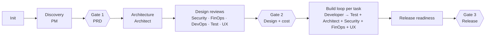

# Software Factory

A Claude Code and Codex plugin with a team of ten AI agents that can take a product from idea to release (or review and extend an existing codebase), working together through a shared handoff contract and stopping for your approval at every important decision.

| Agent | What it does |
|---|---|
| **Team Lead** | Runs the process: plans, delegates, tracks the status board, enforces the gates, curates the factory brain, talks to you |
| **Triage Classifier** | Classifies every new request first (type, size, path, which reviewers are needed) so small work takes the fast path. Read-only, runs on Haiku |
| **Product Manager** | Vision, PRD with measurable goals and NFRs, backlog of stories with Given/When/Then acceptance criteria, release acceptance |
| **Software Architect** | Mermaid repo maps, system design, ADRs, contracts, task breakdown, coding standards, and code review (clean code, OOD, DRY, patterns, scalability) |
| **Software Developer** | Implements one task at a time with unit tests, on a local branch; fixes review findings |
| **Test Automation Engineer** | Test strategy, integration/contract/E2E/performance tests, per-task verification, release regression |
| **DevOps Engineer** | Environments, containers, CI/CD, infrastructure as code, observability, runbooks — validated by dry runs |
| **FinOps Engineer** | Cost model with sourced prices, cost guardrails, cost reviews of changes, actual-vs-forecast |
| **Security Engineer** | Threat model (STRIDE), security requirements (ASVS), security reviews and scans, final release gate |
| **UX/UI Designer** | User flows, textual screen specs and design tokens, usability and accessibility (WCAG 2.2 AA) reviews of UI changes, final UX gate |

## How it works



- **Triage first.** The Team Lead classifies clear small requests inline using the Triage Classifier rules and delegates ambiguous or substantial ones. The resulting path (`fast-path` up to `full-lifecycle`) decides how much process runs. The Team Lead can add process, never remove it without you.
- **A factory brain per repo.** `docs/factory/brain.md` holds short, verified facts about the repo (build quirks, recurring findings) that every agent reads. Agents propose notes; only the Team Lead writes them.
- **Bounded, evidence-based loops.** At most three fix rounds per task and three attempts per failing check; "done" means command output re-run by the Test Engineer and the Architect, not the Developer's word. Every task ends as `done`, `blocked`, `max-rounds` or `stalled`.
- **One contract, one owner per artifact.** `reference/handoff-contract.md` defines every path, ID, severity level, the Definition of Done and the reply format. Every agent reads it first.
- **Your project's specifics live in your repo**, not in the agents: `docs/architecture/project-facts.md` (stack, cloud, compliance, budget), `docs/standards/coding-standards.md`, the PRD, ADRs and so on. The same agents work on any project.
- **The Team Lead is your main session.** Subagents can't ask you questions, so they return their questions to the Team Lead, which batches them for you.
- **Work is tracked in GitHub.** Tasks and findings are GitHub issues on one GitHub Project board (Todo, In Progress, In Review, Changes Requested, Done, Blocked). `docs/factory/status.md` only holds the phase, gates and open questions. The Team Lead works only on the issues you name.
- **Infrastructure has its own gate.** DevOps runs the IaC plan and reviews it, the Architect and FinOps review it, and only after all three approve and you approve the report does DevOps apply.
- **Nothing irreversible without you.** No push, merge to main, deploy, infrastructure apply, paid resource or data deletion happens without your explicit approval of that specific action. In Claude Code a hook asks for confirmation on the common ones; see [docs/TRUST.md](docs/TRUST.md) for the limits.

## What's new in 0.5.0

- **Say "team lead".** Typing "team lead, <request>" (or "team leader") hands the session to the Team Lead. No slash command needed.
- **Code-enforced gates (Claude Code).** Hooks ask before pushes, merges, deploys, infrastructure changes, publishes and recursive force deletes, refuse shell-written file edits from subagents, check that every subagent reply has the required fields, and remind the Team Lead to resume after compaction. See [docs/TRUST.md](docs/TRUST.md) for what is enforced and what is still a prompt.
- **Briefs with claims.** Every delegation says what "done" means (named claims, each with the check that decides it) and what the sender is least sure of. Replies answer each claim.
- **Skeptic pass.** A Blocker or Major finding gets one read-only agent whose only job is to refute it with evidence. Nothing is dropped silently.
- **Review routing.** `scripts/review-route` reads the diff (paths, added lines and removed lines) and says which reviewers are required and whether the review is standard or deep. It can add reviewers, never drop one.
- **One runner per worktree, mutation checks, zero errors in logs.** Only one agent runs tests or builds in a shared worktree. Critical tests are proven by a one-line mutation in a disposable worktree. Logs must be clean, and noisy logs are fixed, not muted.
- **Long jobs, local tracking, restart safety.** Agents hand back `in-progress` with a job to check. `Tracking: local` keeps work out of GitHub. A `## In flight` table plus the `resume` skill and a compaction hook make restarts safe.
- **Session settings.** `session-setup` writes auto-compact and exact-command permissions to the project's `.claude/settings.json`, after you approve the diff.
- **Links, not numbers.** Every issue, PR, commit, CI run or work item (GitHub, Jira, any tracker) the factory mentions is a clickable link, so you never have to look one up (contract rule 9.14).
- **Team table.** Every status while work is running starts with a table of agents (model, worktree, task, last update) and a separate table of background processes. Inherited models and coordinators that run no model are labelled as such.
- **GitHub Actions budget.** FinOps forecasts CI minutes and storage, reads actual Actions usage (read-only), flags waste in workflows, and reviews every CI workflow change.
- **Retro asset and plan drift batching.** Each epic ends with a retro that must name the asset it produced. Plan-text fixes are batched into one Architect pass.
- Where ideas came from: [docs/provenance.md](docs/provenance.md). Backlog: [docs/improvement-backlog.md](docs/improvement-backlog.md).

## Install (once per machine)

This repo is the single source of truth. Install the plugin once at **user scope**, so every project on the machine gets the team. You don't need to install it again per project.

In the Claude Code chat box in VS Code (these are chat commands, not shell commands):

```text
/plugin marketplace add achisolomon/software-factory
/plugin install software-factory@software-factory-marketplace
```

When asked for the scope, choose **Install for you** (user scope).

Or from a regular terminal:

```bash
claude plugin marketplace add achisolomon/software-factory
claude plugin install software-factory@software-factory-marketplace --scope user
```

The repo is private, so the machine needs GitHub access to it (`gh auth login` or Git credentials for `achisolomon`).

## Add the factory to a new project

1. **Open the project folder in VS Code.** Ideally it's a Git repo with a GitHub remote, so the team can track work as GitHub issues.
2. **Make sure `gh` is logged in with the `project` scope** so the Team Lead can create the GitHub Project board:
   ```bash
   gh auth status
   gh auth refresh -s project   # only if "project" is missing from the scopes
   ```
   Without it, init still works, and tasks are tracked in `docs/architecture/tasks.md` instead.
3. **Start a new Claude Code chat** (plugins load when a session starts; a chat opened before the install won't see the plugin).
4. **Run init**: type `/factory` in the chat box and pick `factory-init`, optionally followed by a one-line description:
   ```text
   /software-factory:factory-init a mobile app for booking dog walkers
   ```
   The slash menu matches skill names, so typing `/software` or `/so` won't find it. Type `/factory`.
5. **Answer the project-facts questions** in one batch: stack or cloud, compliance (PII, payments, GDPR...), monthly budget, whether agents may create local branches and commits, and similar.
6. **Review what it created** (init also offers `/software-factory:session-setup`, which proposes auto-compact and exact-command permission rules for `.claude/settings.json` and writes them only after you approve the diff):
   - `docs/factory/status.md`: phase, gates, open questions.
   - `docs/architecture/project-facts.md`: your answers, plus the GitHub Project link.
   - For an existing codebase: `docs/architecture/repo-map.md` (Mermaid map) and `docs/standards/coding-standards.md`.
   - A GitHub Project board for the repo, with columns Todo, In Progress, In Review, Changes Requested, Done, Blocked.
7. **Commit the `docs/` folder** so the team's state is versioned with the code.
8. **Start building**: just say `team lead, <what to build>` (or "team leader"), or use `/software-factory:build <what to build>`. Name the GitHub issues you want worked on (for example `#12 and #15`). The Team Lead never picks issues by itself.

Run init once per project. Running it again on an initialized project just summarizes the current state.

**Troubleshooting**
- "No matching commands": open a new chat, or reload VS Code (`Cmd+Shift+P` → **Developer: Reload Window**), then type `/factory`.
- Check what is installed with `/plugin` in the chat, or `claude plugin list` in a terminal. software-factory should show as enabled, user scope, at the latest version.

## Updating

Editing this checkout does not update an installed plugin or another repo's local runtime. Before publishing a release, bump the matching version in `plugin.json`, `.codex-plugin/plugin.json`, and `.claude-plugin/plugin.json`, then commit and push through the usual approval process. Follow [Update the factory in another repository](#update-the-factory-in-another-repository) for installation-specific commands.

To test the current checkout locally in Claude Code before publishing, run from this repository root:

```bash
claude --plugin-dir .
```

## Use

In the project you want the team to work on:

| Command | What happens |
|---|---|
| `/software-factory:factory-init [description]` | Creates the `docs/` scaffold, captures project facts, maps an existing repo and derives coding standards |
| `team lead, <request>` | Say it in any message. Your session becomes the Team Lead (same as `build`). A bare "team lead" gives the status summary |
| `/software-factory:build <request>` | Your session becomes the Team Lead and runs the full process for a product, feature or fix |
| `/software-factory:session-setup` | Proposes project settings (auto-compact, exact-command allow rules) and writes them after you approve |
| `/software-factory:resume` | After a restart or compaction, reconciles the `## In flight` table before any new dispatch |
| `/software-factory:review [task \| branch \| path \| all]` | Parallel architecture, security, test and (if relevant) cost review with one consolidated verdict |

You can also run the whole session as the Team Lead: `claude --agent software-factory:team-lead`. Adding `--permission-mode auto` is recommended; the gate hook still asks before irreversible actions.

Or call any specialist directly, for example:

```text
@agent-software-factory:software-architect map this repo and review the payments module
@agent-software-factory:security-engineer threat-model docs/architecture/architecture.md
```

## Customize

- **Claude Code models**: the Team Lead picks the model for each delegation by the kind of work (Haiku for triage and mechanical steps, Sonnet for routine build and review, Opus for PRD, architecture, threat modeling and final gates). Set `Model policy: default | conserve | quality` in `project-facts.md`, or just say "conserve my limits" mid-session; conserving changes models, never steps or gates. Each agent's frontmatter `model:` is only the fallback.
- **Codex models**: use `scripts/run-codex-agent` to launch a role with an explicit Codex model. Its cost-effective defaults and escalation rules are in `reference/codex-model-routing.md`; it does not alter the Claude frontmatter. For example:
  ```bash
  # Run from the project the agents should work on.
  /path/to/software-factory/scripts/run-codex-agent software-developer -- 'Implement task T-027 and run its unit tests.'
  /path/to/software-factory/scripts/run-codex-agent test-automation-engineer --mode routine -- 'Verify task T-027 against its acceptance criteria.'
  /path/to/software-factory/scripts/run-codex-agent team-lead -- 'Plan and deliver task T-027 through the factory.'
  ```
  Pass `--model <model-id>` only for a supported, deliberate escalation. Run `codex debug models` to see the models your account can use.
  Add `--dry-run` to inspect the resolved role and model without starting a Codex session.
  The interactive `team-lead` role requires the target project to be a Git repository; run `git init` first for a new project. Specialist roles support non-Git targets.
- **Install Codex support in another project**: run this from the factory repository, once per target project. It installs the agents, contract, model policy, and runner to the project-local `.codex/software-factory/` directory without changing the project's `AGENTS.md`:
  ```bash
  ./scripts/install-codex-factory --project-dir /path/to/project
  cd /path/to/project
  ./.codex/software-factory/scripts/run-codex-agent team-lead -- 'Build a dashboard for support tickets.'
  ```
  For an existing installation, use `--update`; the installer preserves the previous runtime in a sibling backup directory. It includes bundled skills and leaves project documents and `AGENTS.md` alone.

## Install as a Codex plugin

Codex installs this plugin into its own cache, not into your project. The quickest GitHub installation is the included installer (run from a checkout of this repository):

```bash
./scripts/install-codex-plugin --project-dir /path/to/project
```

It installs the marketplace once for your Codex user, installs the plugin, and enables it for the specified project. Start a new Codex chat afterwards and ask Codex to use Software Factory.

To install it manually, or from GitHub without cloning the repository, run:

```bash
codex plugin marketplace add achisolomon/software-factory --sparse .agents/plugins
codex plugin add software-factory@software-factory-marketplace
```

Enable it in a specific existing repository by adding this to `<project>/.codex/config.toml` (create the directory and file if needed):

```toml
[plugins."software-factory@software-factory-marketplace"]
enabled = true
```

Restart Codex or begin a new chat after installation. Each release must bump the matching version in `plugin.json`, `.codex-plugin/plugin.json`, and `.claude-plugin/plugin.json` before it is published.

To update a GitHub marketplace installation, run `codex plugin marketplace upgrade software-factory-marketplace`, then start a new chat. If Codex reports that the marketplace is not configured as Git (for example, it was added from a local path), replace that entry with the GitHub marketplace:

```bash
codex plugin marketplace remove software-factory-marketplace
codex plugin marketplace add achisolomon/software-factory --sparse .agents/plugins
codex plugin marketplace upgrade software-factory-marketplace
```

The add command works from any directory and requires GitHub access. If the plugin isn't installed after the marketplace refresh, install it with `codex plugin add software-factory@software-factory-marketplace`. Start a new chat to load the updated plugin. Marketplace upgrades fetch committed GitHub content; local changes appear only after they are committed and published to the configured branch.

For a private repository, authenticate Git with GitHub first (`gh auth login` or SSH/HTTPS Git credentials). The marketplace command uses those credentials; users do not need to clone this repository.
- **Override one agent for one project**: copy its file to that project's `.claude/agents/` and edit it. A project-level agent with the same `name` takes priority over the plugin's.
- **Project memory**: specialists keep learnings in `.claude/agent-memory/<agent>/` per project. Commit it to share with your team, or add it to `.gitignore`.

## Layout

```
software-factory/
├── .agents/plugins/
│   └── marketplace.json
├── .codex-plugin/
│   └── plugin.json
├── .claude-plugin/
│   ├── plugin.json
│   └── marketplace.json
├── agents/          10 agent definitions
├── hooks/           gate, reply check, model check, after-compact, team-lead trigger
├── assets/          Codex marketplace icon and logo
├── plugin.json       portable Agent Plugins manifest
├── scripts/
│   ├── install-codex-plugin
│   ├── install-codex-factory
│   ├── review-route
│   └── run-codex-agent
├── skills/          factory-init, build, team-lead, review, resume, session-setup, factory-protocol, frontend-testing
├── reference/
│   ├── codex-model-routing.md
│   └── handoff-contract.md
├── docs/
│   ├── TRUST.md                 what code enforces and what relies on prompts
│   ├── provenance.md            outside sources we adapted
│   └── improvement-backlog.md   ideas from similar projects: done, planned, declined
└── README.md
```

## Economical operation (0.4.0)

The existing Test Automation Engineer uses the bundled `frontend-testing` skill for web UI work; no extra QA agent is added. The skill covers page analysis, canonical tests, accessible selectors, network mocking, real-backend critical journeys, trace-based diagnosis and targeted stability runs.

Codex routing defaults coordination and routine QA/UX/cost checks to GPT-6 Luna; substantial implementation and independent code review use GPT-6.1 Sol. Any role can use `--mode routine` for a small specified task, or `--mode quality` for complex work. Astra requires an explicit escalation after Sol evidence. See [the routing policy](reference/codex-model-routing.md). Choose Standard speed in the app; the runner does not change the main chat's model, speed or reasoning settings.

Keep task context focused, classify clear small requests inline, run conditional specialists only when relevant, and return bounded evidence. Required reviews and user gates remain in place. Model selection for native delegation depends on the host's available controls; disclose when it cannot be enforced.

## Update the factory in another repository

Changes in this checkout are available locally now. Marketplace commands receive them only after version 0.5.0 has been committed and published to the marketplace's configured GitHub source. Editing this checkout does not update cached plugins or project-local runtime copies. Start a new chat after updating.

### Project-local Codex runtime (`.codex/software-factory/`)

Run from this factory checkout, replacing the target path:

```bash
./scripts/install-codex-factory --project-dir /path/to/other-repo --update
```

The updater stages the new runtime, backs up the previous directory to `.codex/software-factory-backup.<unique-suffix>/`, and installs agents, skills, reference and scripts. Local runtime customizations remain in that backup; compare and reapply deliberate customizations. It does not overwrite `docs/`, project code, `AGENTS.md` or Codex configuration. Stop active factory agents before updating.

Verify the selected model without spending inference quota:

```bash
cd /path/to/other-repo
./.codex/software-factory/scripts/run-codex-agent team-lead --dry-run -- 'Check the factory setup.'
./.codex/software-factory/scripts/run-codex-agent software-developer --mode routine --dry-run -- 'Check routine routing.'
```

Both commands should report `model=gpt-6-luna`. For substantial work, `--mode quality` should report `model=gpt-6.1-sol`. Start work with:

```bash
./.codex/software-factory/scripts/run-codex-agent team-lead -- 'Implement task T-027 with economical model routing.'
```

### Codex marketplace plugin

After publication, update the user-level marketplace and start a new chat in the target repo:

```bash
codex plugin marketplace upgrade software-factory-marketplace
```

If the target also has a project-local runtime, update that separately using the command above. In the new chat select GPT-6 Luna at Standard speed for coordination and invoke Software Factory. An already-running chat keeps its current model and loaded instructions.

### Claude Code marketplace plugin

After publication, run `/plugin marketplace update software-factory-marketplace`, then `/plugin update software-factory@software-factory-marketplace` in Claude Code and restart the session. Codex model names do not apply to Claude; its existing model policy remains separate.
