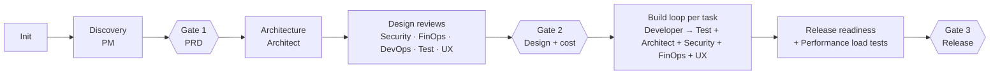

<p align="center">
  
</p>

# Software Factory

**Your spec in. A tested, reviewed, release-ready product out.**

Everyone can build a software factory. The best one will be built together.

Software Factory is an open-source product team made of 10+ AI agents (Architect, Developer, Tester, PM, Security, UX and more) for Claude Code, with experimental Codex support. Take it, use it on your projects, and when it misses something, fix it here so nobody else hits the same wall.

**[Use it](#install-once-per-machine). [Improve it](#contribute). [Star it](https://github.com/achisolomon/software-factory).** Together we can make it the best software factory ever.

**What you get:**

- **A full engineering team in your editor**: Architect, Developer, Tester, Product Manager, Security, FinOps, DevOps, UX and Performance, led by a Team Lead you talk to.
- **Quality you can check**: every task is tested and reviewed, and "done" means re-run command output, not an agent's word.
- **You stay in control**: no push, merge, deploy, paid resource or data deletion without your explicit approval.

**Bring your own spec.** There are great spec-driven development tools already, and the factory uses them instead of replacing them. Write your spec with the tool you like (for example [Superpowers](https://github.com/obra/superpowers), [BMAD](https://github.com/bmad-code-org/BMAD-METHOD), [OpenSpec](https://github.com/Fission-AI/OpenSpec) or [Spec Kit](https://github.com/github/spec-kit); [compare spec-driven tools](https://aitoolreview.ai/?subcategory=spec-driven)), then hand it to the Team Lead. The Team Lead expects a good spec before the team starts. The Product Manager checks it for gaps (metrics, NFRs, testable acceptance criteria) without rewriting it, and the team takes it from there through architecture, build, review and release.

## See it work

A real run on [aitoolreview.ai](https://aitoolreview.ai): the Team Lead dispatches the Product Manager, Architect, UX Designer, Developer and DevOps, and posts the team table as they work. Press play, pause any time, or open it full screen.

https://github.com/user-attachments/assets/d3ba3655-e66e-4ae4-b988-73b25effd499

## Contribute

Use it, enjoy it, and make it better. Every improvement you make for your own projects can make the factory better for everyone:

- **Found a gap?** [Open an issue](https://github.com/achisolomon/software-factory/issues/new): a review the agents missed, a gate that was too loose or too strict, a step that wasted time or tokens.
- **Want to start small?** Pick a [`good first issue`](https://github.com/achisolomon/software-factory/labels/good%20first%20issue).
- **Fixed it?** Open a pull request. Agent prompts live in `agents/`, the shared rules in `reference/handoff-contract.md`, and the code-enforced gates in `hooks/`. See [CONTRIBUTING.md](CONTRIBUTING.md).
- **Have an idea?** Check [docs/improvement-backlog.md](docs/improvement-backlog.md) first, then start a [discussion](https://github.com/achisolomon/software-factory/discussions).
- **Like it?** Give it a star and tell a friend.

Released under the [GNU AGPL-3.0](LICENSE): free to use, change and share, including at work. If you distribute a modified version or run it as a service for others, you must publish your source under the same license. The code the agents write in your own project is yours; the license covers the factory itself.

## The team

| Agent | What it does |
|---|---|
| **Team Lead** | Runs the process: plans, delegates, tracks the status board, enforces the gates, curates the factory brain, talks to you |
| **Triage Classifier** | Classifies every new request first (type, size, path, which reviewers are needed) so small work takes the fast path. Read-only, runs on Haiku |
| **Product Manager** | Vision, PRD with measurable goals and NFRs, backlog of stories with Given/When/Then acceptance criteria, release acceptance |
| **Software Architect** | Mermaid repo maps, system design, ADRs, contracts, task breakdown, coding standards, and code review (clean code, OOD, DRY, patterns, scalability) |
| **Software Developer** | Implements one task at a time with unit tests, on a local branch; fixes review findings |
| **Test Automation Engineer** | The team's devil's advocate: test strategy, integration/contract/E2E tests, per-task verification that hunts for where the code breaks, prefers test-first and enforces API-first (anything not testable by automation is a Major for the Architect and Developer), release regression |
| **DevOps Engineer** | Environments, containers, CI/CD, infrastructure as code, observability, runbooks — validated by dry runs |
| **FinOps Engineer** | Cost model with sourced prices, cost guardrails, cost reviews of changes, actual-vs-forecast |
| **Security Engineer** | Threat model (STRIDE), security requirements (ASVS), security reviews and scans, final release gate |
| **UX/UI Designer** | User flows, textual screen specs and design tokens, usability and accessibility (WCAG 2.2 AA) reviews of UI changes, final UX gate |
| **Performance Engineer** | Load tester and sizing expert, on Opus: finds what breaks under load (missing indexes, N+1, deadlocks, pool limits), sizes the system against the NFRs, plans and runs load tests, reports each bottleneck with its cause and fix. Runs before a merge to main or a deploy, and when you ask, not per task |

Current version: 0.6.4. What changed in each release, newest first: [release notes](CHANGELOG.md).

## Install (once per machine)

This repo is the single source of truth. Install the plugin once at **user scope**, so every project on the machine gets the team. You don't need to install it again per project.

1. **Paste this one line into a terminal** (in VS Code: Terminal > New Terminal, not the Claude chat box):

   ```bash
   claude plugin marketplace add achisolomon/software-factory && claude plugin install software-factory@software-factory-marketplace --scope user
   ```

   It ends with `Successfully installed plugin: software-factory@software-factory-marketplace (scope: user)`.

2. **Reload VS Code**: Cmd+Shift+P, then **Developer: Reload Window**.
3. **Open a new Claude Code chat.** Its first reply starts with `Software Factory v<version>`. That means the team is loaded.

Then follow [Add the factory to a new project](#add-the-factory-to-a-new-project).

## How it works



- **Triage first.** The Team Lead classifies clear small requests inline using the Triage Classifier rules and delegates ambiguous or substantial ones. The resulting path (`fast-path` up to `full-lifecycle`) decides how much process runs. The Team Lead can add process, never remove it without you.
- **A factory brain per repo.** `docs/factory/brain.md` holds short, verified facts about the repo (build quirks, recurring findings) that every agent reads. Agents propose notes; only the Team Lead writes them.
- **Bounded, evidence-based loops.** At most three fix rounds per task and three attempts per failing check; "done" means command output re-run by the Test Engineer and the Architect, not the Developer's word. Every task ends as `done`, `blocked`, `max-rounds` or `stalled`.
- **One contract, one owner per artifact.** `reference/handoff-contract.md` defines every path, ID, severity level, the Definition of Done and the reply format. Every agent reads it first.
- **Your project's specifics live in your repo**, not in the agents: `docs/architecture/project-facts.md` (stack, cloud, compliance, budget), `docs/standards/coding-standards.md`, the PRD, ADRs and so on. The same agents work on any project.
- **The Team Lead is your main session.** Subagents can't ask you questions, so they return their questions to the Team Lead, which batches them for you.
- **Work is tracked in GitHub.** Tasks and findings are GitHub issues on one GitHub Project board (Todo, In Progress, In Review, Changes Requested, Done, Blocked). `docs/factory/status.md` only holds the phase, gates and open questions. The Team Lead works only on the issues you name.
- **Infrastructure has its own gate.** DevOps runs the IaC plan and reviews it, the Architect and FinOps review it, and only after all three approve and you approve the report does DevOps apply.
- **Nothing irreversible without you.** No push, merge to main, deploy, infrastructure apply, paid resource or data deletion happens without your explicit approval of that specific action. In Claude Code a hook asks for confirmation on the common ones; see [docs/TRUST.md](docs/TRUST.md) for the limits.
- Where ideas came from: [docs/provenance.md](docs/provenance.md). Backlog: [docs/improvement-backlog.md](docs/improvement-backlog.md).

## Add the factory to a new project

1. **Open the project folder in VS Code** and start a new Claude Code chat (a chat opened before the install won't see the plugin).
2. **Write a good spec.** The Team Lead expects a clear spec before the team starts. Write it with a spec-driven development tool such as Superpowers, BMAD, OpenSpec or Spec Kit ([compare spec-driven tools on AI Tool Review](https://aitoolreview.ai/?subcategory=spec-driven)). The Product Manager reviews the spec for gaps before work starts, but writing the spec is not the team's focus: a better spec gives a better product.
3. **Say "team lead".** That's it:
   ```text
   team lead, build docs/spec.md
   ```
   ("team leader" works too.) The first time in a project, the Team Lead offers to set the factory up: it asks a few project questions in one batch (stack, compliance, budget, whether agents may commit locally) and creates `docs/factory/` and a GitHub Project board. Then the team goes to work, and stops for your approval at every important decision.

**Tips**
- For GitHub issue tracking, give `gh` the `project` scope once: `gh auth refresh -s project`. Without it, tasks are tracked in `docs/architecture/tasks.md`.
- Commit the `docs/` folder now and then, so the team's state is versioned with the code.
- To set up without starting work, run `/software-factory:factory-init` (type `/factory` in the chat box to find it).

**Troubleshooting**
- "No matching commands": open a new chat, or reload VS Code (`Cmd+Shift+P` → **Developer: Reload Window**), then type `/factory`.
- Check what is installed with `claude plugin list` in a terminal. software-factory should show as enabled, user scope, at the latest version.

## Updating

**Which version am I running?** At the start of every session (terminal or the VS Code extension) a hook shows `Software Factory v<version>`, says whether it is the latest, and gives the update command when a newer version is published on GitHub `main` (checked at most every 6 hours). The Team Lead also starts its first status with the version. In a terminal, `claude plugin list` shows it too.

**Update** when the session start says a newer version is available. Either ask Claude in the chat to "update the software factory" (approve the command it runs), or paste this one line into the VS Code terminal (Terminal > New Terminal):

```bash
claude plugin marketplace update software-factory-marketplace && claude plugin update software-factory@software-factory-marketplace --scope user
```

Then run Developer: Reload Window (Cmd+Shift+P) or restart Claude Code, and start a new chat. A chat that is already open keeps the old instructions.

Editing this checkout does not update an installed plugin or another repo's local runtime. Before publishing a release, bump the matching version in `plugin.json`, `.codex-plugin/plugin.json`, and `.claude-plugin/plugin.json`, then commit and push through the usual approval process.

To test the current checkout locally in Claude Code before publishing, run from this repository root:

```bash
claude --plugin-dir .
```

## Use

In the project you want the team to work on:

| Command | What happens |
|---|---|
| `team lead, <request>` | Say it in any message. Your session becomes the Team Lead (same as `build`). A bare "team lead" gives the status summary |
| `/software-factory:status` | The one you'll use most. Shows the Team table now: who is running, blocked, done, and what is next. Read-only. The Team Lead also posts it every 15 minutes during a run (`Status cadence: off` in project facts turns that off) |
| `/software-factory:review [task \| branch \| path \| all]` | Parallel architecture, security, test and (if relevant) cost review with one consolidated verdict |
| `/software-factory:resume` | After a restart or compaction, reconciles the `## In flight` table before any new dispatch |
| `/software-factory:build <request>` | Your session becomes the Team Lead and runs the full process for a product, feature or fix |
| `/software-factory:factory-init [description]` | Creates the `docs/` scaffold, captures project facts, maps an existing repo and derives coding standards (the Team Lead runs it for you the first time) |
| `/software-factory:session-setup` | Proposes project settings (auto-compact, exact-command allow rules) and writes them after you approve |

You can also run the whole session as the Team Lead: `claude --agent software-factory:team-lead`. Adding `--permission-mode auto` is recommended; the gate hook still asks before irreversible actions.

Or call any specialist directly, for example:

```text
@agent-software-factory:software-architect map this repo and review the payments module
@agent-software-factory:security-engineer threat-model docs/architecture/architecture.md
```

## Customize

- **Claude Code models**: the Team Lead picks the model for each delegation by the kind of work (Haiku for triage and mechanical steps, Sonnet for routine build and review, Opus for PRD, architecture, threat modeling and final gates). Fable runs only when you ask for it. Set `Model policy: default | conserve | quality` in `project-facts.md`, or just say "conserve my limits" mid-session; conserving changes models, never steps or gates. Set `Pace: speed` (or say "I want speed") to trade extra checking for speed: fewer optional reviewers and skeptic runs, independent tasks in parallel; gates, approvals and Security stay. Each agent's frontmatter `model:` is only the fallback.
- **Override one agent for one project**: copy its file to that project's `.claude/agents/` and edit it. A project-level agent with the same `name` takes priority over the plugin's.
- **Project memory**: specialists keep learnings in `.claude/agent-memory/<agent>/` per project. Commit it to share with your team, or add it to `.gitignore`.

**About "marketplace".** This repo is its own plugin marketplace (`software-factory-marketplace`, defined in `.claude-plugin/marketplace.json`). It is not listed in the official Claude Code or Codex marketplaces; the install line registers this repo directly.

**Frontend testing.** The Test Automation Engineer uses the bundled `frontend-testing` skill for web UI work: page analysis, canonical tests, accessible selectors, network mocking, real-backend critical journeys, trace-based diagnosis and targeted stability runs.

## Layout

```
software-factory/
├── .agents/plugins/
│   └── marketplace.json
├── .codex-plugin/
│   └── plugin.json
├── .claude-plugin/
│   ├── plugin.json
│   └── marketplace.json
├── agents/          11 agent definitions
├── hooks/           gate, reply check, model check, after-compact, team-lead trigger
├── assets/          README images, marketplace icon and logo
├── plugin.json       portable Agent Plugins manifest
├── scripts/
│   ├── install-codex-plugin
│   ├── install-codex-factory
│   ├── review-route
│   └── run-codex-agent
├── skills/          factory-init, build, team-lead, review, resume, status, health, session-setup, factory-protocol, frontend-testing
├── reference/
│   ├── codex-model-routing.md
│   └── handoff-contract.md
├── docs/
│   ├── TRUST.md                 what code enforces and what relies on prompts
│   ├── provenance.md            outside sources we adapted
│   └── improvement-backlog.md   ideas from similar projects: done, planned, declined
├── CHANGELOG.md     release notes
├── CONTRIBUTING.md  how to contribute
├── LICENSE          AGPL-3.0
└── README.md
```

## Codex (experimental, untested)

Codex support exists (installers, a role runner and model routing, all with offline tests), but nobody has run it end to end on a real project yet. If you use Codex, please try it and [tell us what breaks](https://github.com/achisolomon/software-factory/issues/new).

- **Codex models**: use `scripts/run-codex-agent` to launch a role with an explicit Codex model. Its cost-effective defaults and escalation rules are in `reference/codex-model-routing.md`; it does not alter the Claude frontmatter. For example:
  ```bash
  # Run from the project the agents should work on.
  /path/to/software-factory/scripts/run-codex-agent software-developer -- 'Implement task T-027 and run its unit tests.'
  /path/to/software-factory/scripts/run-codex-agent test-automation-engineer --mode routine -- 'Verify task T-027 against its acceptance criteria.'
  /path/to/software-factory/scripts/run-codex-agent team-lead -- 'Plan and deliver task T-027 through the factory.'
  ```
  Pass `--model <model-id>` only for a supported, deliberate escalation. Run `codex debug models` to see the models your account can use.
  Add `--dry-run` to inspect the resolved role and model without starting a Codex session.
  The interactive `team-lead` role requires the target project to be a Git repository; run `git init` first for a new project. Specialist roles support non-Git targets.
- **Install Codex support in another project**: run this from the factory repository, once per target project. It installs the agents, contract, model policy, and runner to the project-local `.codex/software-factory/` directory without changing the project's `AGENTS.md`:
  ```bash
  ./scripts/install-codex-factory --project-dir /path/to/project
  cd /path/to/project
  ./.codex/software-factory/scripts/run-codex-agent team-lead -- 'Build a dashboard for support tickets.'
  ```
  For an existing installation, use `--update`; the installer preserves the previous runtime in a sibling backup directory. It includes bundled skills and leaves project documents and `AGENTS.md` alone.

### Install as a Codex plugin

Codex installs this plugin into its own cache, not into your project. The quickest GitHub installation is the included installer (run from a checkout of this repository):

```bash
./scripts/install-codex-plugin --project-dir /path/to/project
```

It installs the marketplace once for your Codex user, installs the plugin, and enables it for the specified project. Start a new Codex chat afterwards and ask Codex to use Software Factory.

To install it manually, or from GitHub without cloning the repository, run:

```bash
codex plugin marketplace add achisolomon/software-factory --sparse .agents/plugins
codex plugin add software-factory@software-factory-marketplace
```

Enable it in a specific existing repository by adding this to `<project>/.codex/config.toml` (create the directory and file if needed):

```toml
[plugins."software-factory@software-factory-marketplace"]
enabled = true
```

Restart Codex or begin a new chat after installation. Each release must bump the matching version in `plugin.json`, `.codex-plugin/plugin.json`, and `.claude-plugin/plugin.json` before it is published.

To update a GitHub marketplace installation, run `codex plugin marketplace upgrade software-factory-marketplace`, then start a new chat. If Codex reports that the marketplace is not configured as Git (for example, it was added from a local path), replace that entry with the GitHub marketplace:

```bash
codex plugin marketplace remove software-factory-marketplace
codex plugin marketplace add achisolomon/software-factory --sparse .agents/plugins
codex plugin marketplace upgrade software-factory-marketplace
```

The add command works from any directory and requires GitHub access. If the plugin isn't installed after the marketplace refresh, install it with `codex plugin add software-factory@software-factory-marketplace`. Start a new chat to load the updated plugin. Marketplace upgrades fetch committed GitHub content; local changes appear only after they are pushed to `main`.

### Codex model routing

Codex routing defaults coordination and routine QA/UX/cost checks to GPT-6 Luna; substantial implementation and independent code review use GPT-6.1 Sol. Any role can use `--mode routine` for a small specified task, or `--mode quality` for complex work. Astra requires an explicit escalation after Sol evidence. See [the routing policy](reference/codex-model-routing.md). Choose Standard speed in the app; the runner does not change the main chat's model, speed or reasoning settings.

Keep task context focused, classify clear small requests inline, run conditional specialists only when relevant, and return bounded evidence. Required reviews and user gates remain in place. Model selection for native delegation depends on the host's available controls; disclose when it cannot be enforced.

### Update a project-local Codex runtime (`.codex/software-factory/`)

Run from this factory checkout, replacing the target path:

```bash
./scripts/install-codex-factory --project-dir /path/to/other-repo --update
```

The updater stages the new runtime, backs up the previous directory to `.codex/software-factory-backup.<unique-suffix>/`, and installs agents, skills, reference and scripts. Local runtime customizations remain in that backup; compare and reapply deliberate customizations. It does not overwrite `docs/`, project code, `AGENTS.md` or Codex configuration. Stop active factory agents before updating.

Verify the selected model without spending inference quota:

```bash
cd /path/to/other-repo
./.codex/software-factory/scripts/run-codex-agent team-lead --dry-run -- 'Check the factory setup.'
./.codex/software-factory/scripts/run-codex-agent software-developer --mode routine --dry-run -- 'Check routine routing.'
```

Both commands should report `model=gpt-6-luna`. For substantial work, `--mode quality` should report `model=gpt-6.1-sol`. Start work with:

```bash
./.codex/software-factory/scripts/run-codex-agent team-lead -- 'Implement task T-027 with economical model routing.'
```

### Update the Codex plugin

After a new version is pushed to `main`, update the user-level marketplace and start a new chat in the target repo:

```bash
codex plugin marketplace upgrade software-factory-marketplace
```

If the target also has a project-local runtime, update that separately using the command above. In the new chat select GPT-6 Luna at Standard speed for coordination and invoke Software Factory. An already-running chat keeps its current model and loaded instructions.
