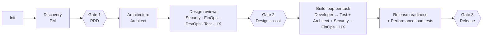

<p align="center">
  
</p>

# Software Factory

**Everyone can build a software factory. The best one will be built together.**

An open-source AI software team for Claude Code: 10+ agents (Architect, Developer, Tester, PM, Security, UX and more) that take your spec to a tested, reviewed release.

**[Use it](#quick-start). [Improve it](#contribute). [Star it](https://github.com/achisolomon/software-factory).**

## See it work

A real run on [aitoolreview.ai](https://aitoolreview.ai): the Team Lead dispatches the Product Manager, Architect, UX Designer, Developer and DevOps, and posts the team table as they work. Press play, pause any time, or open it full screen.

https://github.com/user-attachments/assets/8dabfe4a-e521-4b5e-9639-d8af3ca6259e

The agents are checked too: 29 behavior evals and 141 offline tests guard their rules and approval gates.

## What you get

- **A full AI software team in your editor**: Architect, Developer, Tester, Product Manager, Security, FinOps, DevOps, UX and Performance, led by a Team Lead you talk to.
- **Quality you can check**: every task is tested and reviewed, and "done" means re-run command output, not an agent's word.
- **You stay in control**: no push, merge, deploy, paid resource or data deletion without your explicit approval.
- **Sensible model costs**: each agent runs on the smallest model that does its job well (see [Meet the team](#meet-the-team)). Haiku handles triage and lookups, Sonnet builds and runs routine reviews, and Opus is kept for product, architecture, security and final gates. Say "conserve my limits" to go cheaper; that changes models, never steps or gates.

## Meet the team

13 agents, what each one does and the model it runs on:

| Agent | Model | What it does |
|---|---|---|
| **Team Lead** | Your session's model (Opus by default) | Runs the process: plans, delegates, tracks the status board, enforces the gates, curates the factory brain, talks to you |
| **Triage Classifier** | Haiku | Classifies every new request first (type, size, path, which reviewers are needed) so small work takes the fast path. Read-only |
| **Product Manager** | Opus | Vision, PRD with measurable goals and NFRs, backlog of stories with Given/When/Then acceptance criteria, release acceptance; files the story issues on GitHub |
| **Project Manager** | Haiku | Keeps the GitHub issues and Project board current: sets up the board, opens missing issues, moves each issue's status and comments as work moves, audits the board before each gate. Runs only `gh` |
| **Software Architect** | Opus for design, Sonnet for routine reviews | Mermaid repo maps, system design, ADRs, contracts, task breakdown, coding standards, and code review (clean code, OOD, DRY, patterns, scalability) |
| **Software Developer** | Sonnet (Opus for a third fix round) | Implements one task at a time with unit tests, on a local branch; fixes review findings |
| **Test Automation Engineer** | Sonnet | The team's devil's advocate: test strategy, integration, contract and E2E tests, per-task verification that hunts for where the code breaks, prefers test-first and enforces API-first, release regression |
| **Exploratory QA Engineer** | Sonnet | Black-box bug hunter: explores the running app like a user at the end of an epic and on request, only in local or disposable environments, writes a failing repro test before reading code, and quarantines it with a marker |
| **DevOps Engineer** | Sonnet | Environments, containers, CI/CD, infrastructure as code, observability, runbooks, all validated by dry runs |
| **FinOps Engineer** | Sonnet | Cost model with sourced prices, cost guardrails, cost reviews of changes, actual-vs-forecast |
| **Security Engineer** | Opus | Threat model (STRIDE), security requirements (ASVS), security reviews and scans, final release gate |
| **UX/UI Designer** | Sonnet | User flows, textual screen specs and design tokens, usability and accessibility (WCAG 2.2 AA) reviews of UI changes, final UX gate |
| **Performance Engineer** | Opus | Load tester and sizing expert: finds what breaks under load (missing indexes, N+1, deadlocks, pool limits), sizes the system against the NFRs, plans and runs load tests. Runs before a merge to main or a deploy, and when you ask, not per task |

Read-only lookups run on Haiku. To change the policy, see [Tips](#tips).

Current version: 0.9.0. What changed in each release, newest first: [release notes](CHANGELOG.md).

## Quick start

1. **Install once per machine.** Paste this line into a terminal (in VS Code: Terminal > New Terminal, not the Claude chat box):

   ```bash
   claude plugin marketplace add achisolomon/software-factory && claude plugin install software-factory@software-factory-marketplace --scope user
   ```

   It ends with `Successfully installed plugin: software-factory@software-factory-marketplace (scope: user)`. Then reload VS Code: Cmd+Shift+P, **Developer: Reload Window**.

2. **Write a good spec.** The Team Lead expects a clear spec before the team starts. Write it with the spec-driven tool you like, such as [Superpowers](https://github.com/obra/superpowers), [BMAD](https://github.com/bmad-code-org/BMAD-METHOD), [OpenSpec](https://github.com/Fission-AI/OpenSpec) or [Spec Kit](https://github.com/github/spec-kit) ([compare spec-driven tools](https://aitoolreview.ai/?subcategory=spec-driven)). The factory uses these tools instead of replacing them: the Product Manager checks your spec for gaps (metrics, NFRs, testable acceptance criteria) but never rewrites it.

3. **Set up the project, once.** Open your project in VS Code, start a new Claude Code chat and run:

   ```text
   /software-factory:factory-init
   ```

   (Type `/factory` in the chat box to find it.) The first reply starts with `Software Factory v<version>`, which means the team is loaded. Init asks a few project questions in one batch (stack, compliance, budget, whether agents may commit locally), then creates `docs/factory/`, maps an existing codebase and sets up a GitHub Project board.

4. **Say "team lead":**

   ```text
   team lead, build docs/spec.md
   ```

   The team goes to work, and stops for your approval at every important decision. (If you skip step 3, the Team Lead offers to run init for you the first time.)

**Troubleshooting**

- "No matching commands": open a new chat, or reload VS Code (Cmd+Shift+P, **Developer: Reload Window**), then type `/factory`.
- Check what is installed with `claude plugin list` in a terminal. software-factory should show as enabled, user scope, at the latest version.

## Tips

- **Spend less and go faster** with these skills, all on [AI Tool Review's cost-reduction list](https://aitoolreview.ai/?tag=cost-reduction):
  - [Ponytail](https://aitoolreview.ai/tools/ponytail/): makes agents write the smallest change that solves the task.
  - [Caveman](https://aitoolreview.ai/tools/caveman/): terse replies that cut output tokens.
  - [Token Optimizer](https://aitoolreview.ai/tools/token-optimizer/): finds where your context and tokens go, and trims it.
  - For writing the spec, [Superpowers](https://aitoolreview.ai/tools/superpowers/) is a good start.
- **Work in a worktree.** Ask Claude to enter a worktree before it starts (Claude Code's `EnterWorktree`), so each session gets its own branch and working copy, and parallel sessions on the same repo never collide. See [AI Tool Review's guide to Claude Code worktrees](https://aitoolreview.ai/guides/claude-code-worktrees/).
- **Compact early.** Once the context passes about half full, compact: long runs get slower, costlier and less accurate as the context fills. `/software-factory:session-setup` sets auto-compact (default 30% of the window) so it happens on its own. The Team Lead keeps its state on disk after every wave, so after a compaction it carries on without a hand-written summary; run `/software-factory:resume` if it seems lost.
- **Models**: the Team Lead sets the model for each delegation by the kind of work (the table in [Meet the team](#meet-the-team)). Fable runs only when you ask for it. Set `Model policy: default | conserve | quality | max` in `project-facts.md`. `max` puts the Team Lead and the Architect's design and reviews on Fable and the rest on Opus. It is not recommended: it can burn through your Claude limits very fast. You can also just say "conserve my limits" mid-session; conserving changes models, never steps or gates. Each agent's frontmatter `model:` is only the fallback.
- **Speed**: set `Pace: speed` (or say "I want speed") to trade extra checking for speed: fewer optional reviewers and skeptic runs, independent tasks in parallel; gates, approvals and Security stay.
- **Project memory**: specialists keep learnings in `.claude/agent-memory/<agent>/` per project. Commit it to share with your team, or add it to `.gitignore`.
- **GitHub issue tracking**: give `gh` the `project` scope once: `gh auth refresh -s project`. Without it, tasks are tracked in `docs/architecture/tasks.md`. Init also offers the GitHub MCP server instead of `gh` for the Product Manager and Project Manager (no shell for them, but you add the server with a personal access token); `gh` is the recommended default.
- **Commit the `docs/` folder** now and then, so the team's state is versioned with the code.

## Contribute

<details>
<summary>Issues, starter tasks, pull requests and ideas</summary>

Every improvement you make for your own projects can make the factory better for everyone:

- **Found a gap?** [Open an issue](https://github.com/achisolomon/software-factory/issues/new): a review the agents missed, a gate that was too loose or too strict, a step that wasted time or tokens.
- **Want to start small?** Pick a [`good first issue`](https://github.com/achisolomon/software-factory/labels/good%20first%20issue).
- **Fixed it?** Open a pull request. Agent prompts live in `plugin/agents/`, the shared rules in `plugin/reference/handoff-contract.md`, and the code-enforced gates in `plugin/hooks/`. See [CONTRIBUTING.md](CONTRIBUTING.md).
- **Have an idea?** Check [docs/improvement-backlog.md](docs/improvement-backlog.md) first, then start a [discussion](https://github.com/achisolomon/software-factory/discussions).
- **Like it?** Give it a star and tell a friend.

</details>

## How it works

<details>
<summary>The lifecycle, gates and rules the team follows</summary>



- **Triage first.** The Team Lead classifies clear small requests inline using the Triage Classifier rules and delegates ambiguous or substantial ones. The resulting path (`fast-path` up to `full-lifecycle`) decides how much process runs. The Team Lead can add process, never remove it without you.
- **A factory brain per repo.** `docs/factory/brain.md` holds short, verified facts about the repo (build quirks, recurring findings) that every agent reads. Agents propose notes; only the Team Lead writes them.
- **Bounded, evidence-based loops.** At most three fix rounds per task and three attempts per failing check; "done" means command output re-run by the Test Engineer and the Architect, not the Developer's word. Every task ends as `done`, `blocked`, `max-rounds` or `stalled`.
- **One contract, one owner per artifact.** `plugin/reference/handoff-contract.md` defines every path, ID, severity level, the Definition of Done and the reply format. Every agent reads it first.
- **Your project's specifics live in your repo**, not in the agents: `docs/architecture/project-facts.md` (stack, cloud, compliance, budget), `docs/standards/coding-standards.md`, the PRD, ADRs and so on. The same agents work on any project.
- **The Team Lead is your main session.** Subagents can't ask you questions, so they return their questions to the Team Lead, which batches them for you.
- **Work is tracked in GitHub.** Tasks and findings are GitHub issues on one GitHub Project board (Todo, In Progress, In Review, Changes Requested, Done, Blocked). `docs/factory/status.md` only holds the phase, gates and open questions. The Team Lead works only on the issues you name.
- **Infrastructure has its own gate.** DevOps runs the IaC plan and reviews it, the Architect and FinOps review it, and only after all three approve and you approve the report does DevOps apply.
- **Nothing irreversible without you.** No push, merge to main, deploy, infrastructure apply, paid resource or data deletion happens without your explicit approval of that specific action. A hook asks for confirmation on the common ones; see [docs/TRUST.md](docs/TRUST.md) for the limits.
- Where ideas came from: [docs/provenance.md](docs/provenance.md). Backlog: [docs/improvement-backlog.md](docs/improvement-backlog.md).

</details>

## Commands

<details>
<summary>Status, review, resume and the other slash commands</summary>

In the project you want the team to work on:

| Command | What happens |
|---|---|
| `team lead, <request>` | Say it in any message. Your session becomes the Team Lead (same as `build`). A bare "team lead" gives the status summary |
| `/software-factory:status` | The one you'll use most. Shows the Team table now: who is running, blocked, done, and what is next. Read-only. The Team Lead also posts it every 15 minutes during a run (`Status cadence: off` in project facts turns that off) |
| `/software-factory:review [task \| branch \| path \| all]` | Parallel architecture, security, test and (if relevant) cost review with one consolidated verdict |
| `/software-factory:resume` | After a restart or compaction, reconciles the `## In flight` table before any new dispatch |
| `/software-factory:build <request>` | Your session becomes the Team Lead and runs the full process for a product, feature or fix |
| `/software-factory:factory-init [description]` | Creates the `docs/` scaffold, captures project facts, maps an existing repo and derives coding standards (the Team Lead runs it for you the first time) |
| `/software-factory:session-setup` | Proposes project settings (auto-compact, exact-command allow rules) and writes them after you approve |

You can also run the whole session as the Team Lead: `claude --agent software-factory:team-lead`. Adding `--permission-mode auto` is recommended; the gate hook still asks before irreversible actions.

Or call any specialist directly, for example:

```text
@agent-software-factory:software-architect map this repo and review the payments module
@agent-software-factory:security-engineer threat-model docs/architecture/architecture.md
```

</details>

## Updating

<details>
<summary>Check your version and update</summary>

**Which version am I running?** At the start of every session (terminal or the VS Code extension) a hook shows `Software Factory v<version>`, says whether it is the latest, and gives the update command when a newer version is published on GitHub `main` (checked at most every 6 hours). The Team Lead also starts its first status with the version. In a terminal, `claude plugin list` shows it too.

**Update** when the session start says a newer version is available. Either ask Claude in the chat to "update the software factory" (approve the command it runs), or paste this one line into the VS Code terminal (Terminal > New Terminal):

```bash
claude plugin marketplace update software-factory-marketplace && claude plugin update software-factory@software-factory-marketplace --scope user
```

Then run Developer: Reload Window (Cmd+Shift+P) or restart Claude Code, and start a new chat. A chat that is already open keeps the old instructions.

</details>

## Customize

<details>
<summary>Override an agent, frontend testing, the marketplace</summary>

- **Override one agent for one project**: copy its file to that project's `.claude/agents/` and edit it. A project-level agent with the same `name` takes priority over the plugin's.
- **Frontend testing**: the Test Automation Engineer uses the bundled `frontend-testing` skill for web UI work: page analysis, canonical tests, accessible selectors, network mocking, real-backend critical journeys, trace-based diagnosis and targeted stability runs.

**About "marketplace".** This repo is its own plugin marketplace (`software-factory-marketplace`, defined in `.claude-plugin/marketplace.json`). It is not listed in the official Claude Code marketplace; the install line registers this repo directly.

</details>

## License

Released under the [GNU AGPL-3.0](LICENSE): free to use, change and share, including at work. If you distribute a modified version or run it as a service for others, you must publish your source under the same license. The code the agents write in your own project is yours; the license covers the factory itself.
