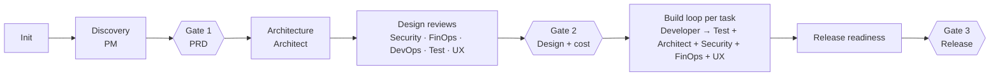

# Software Factory

A Claude Code plugin with a team of nine AI agents that can take a product from idea to release — or review and extend an existing codebase — working together through a shared handoff contract and stopping for your approval at every important decision.

| Agent | What it does |
|---|---|
| **Team Lead** | Runs the process: plans, delegates, tracks the status board, enforces the gates, talks to you |
| **Product Manager** | Vision, PRD with measurable goals and NFRs, backlog of stories with Given/When/Then acceptance criteria, release acceptance |
| **Software Architect** | Mermaid repo maps, system design, ADRs, contracts, task breakdown, coding standards, and code review (clean code, OOD, DRY, patterns, scalability) |
| **Software Developer** | Implements one task at a time with unit tests, on a local branch; fixes review findings |
| **Test Automation Engineer** | Test strategy, integration/contract/E2E/performance tests, per-task verification, release regression |
| **DevOps Engineer** | Environments, containers, CI/CD, infrastructure as code, observability, runbooks — validated by dry runs |
| **FinOps Engineer** | Cost model with sourced prices, cost guardrails, cost reviews of changes, actual-vs-forecast |
| **Security Engineer** | Threat model (STRIDE), security requirements (ASVS), security reviews and scans, final release gate |
| **UX/UI Designer** | User flows, textual screen specs and design tokens, usability and accessibility (WCAG 2.2 AA) reviews of UI changes, final UX gate |

## How it works



- **One contract, one owner per artifact.** `reference/handoff-contract.md` defines every path, ID, severity level, the Definition of Done and the reply format. Every agent reads it first.
- **Your project's specifics live in your repo**, not in the agents: `docs/architecture/project-facts.md` (stack, cloud, compliance, budget), `docs/standards/coding-standards.md`, the PRD, ADRs and so on. The same agents work on any project.
- **The Team Lead is your main session.** Subagents can't ask you questions, so they return their questions to the Team Lead, which batches them for you.
- **Work is tracked in GitHub.** Tasks and findings are GitHub issues on one GitHub Project board (Todo, In Progress, In Review, Changes Requested, Done, Blocked). `docs/factory/status.md` only holds the phase, gates and open questions. The Team Lead works only on the issues you name.
- **Infrastructure has its own gate.** DevOps runs the IaC plan and reviews it, the Architect and FinOps review it, and only after all three approve and you approve the report does DevOps apply.
- **Nothing irreversible without you.** No push, merge to main, deploy, infrastructure apply, paid resource or data deletion happens without your explicit approval of that specific action.

## Install

This repo is the single source of truth. Install it once at user scope so every project gets it:

```text
/plugin marketplace add achisolomon/software-factory
/plugin install software-factory@software-factory-marketplace
```

## Updating

Claude Code runs an installed copy from its plugin cache, cached by version. Editing this repo does not change it on its own. To release a change:

1. Edit the files in this repo (never the cached copy under `~/.claude/plugins/cache/`).
2. Bump `version` in `.claude-plugin/plugin.json`.
3. Commit and push.
4. In Claude Code: `/plugin marketplace update software-factory-marketplace`, then restart the session.

To try it locally without publishing:

```bash
claude --plugin-dir ./software-factory
```

## Use

In the project you want the team to work on:

| Command | What happens |
|---|---|
| `/software-factory:factory-init [description]` | Creates the `docs/` scaffold, captures project facts, maps an existing repo and derives coding standards |
| `/software-factory:build <request>` | Your session becomes the Team Lead and runs the full process for a product, feature or fix |
| `/software-factory:review [task \| branch \| path \| all]` | Parallel architecture, security, test and (if relevant) cost review with one consolidated verdict |

You can also run the whole session as the Team Lead: `claude --agent software-factory:team-lead`.

Or call any specialist directly, for example:

```text
@agent-software-factory:software-architect map this repo and review the payments module
@agent-software-factory:security-engineer threat-model docs/architecture/architecture.md
```

## Customize

- **Models**: each agent sets `model:` in its frontmatter (Opus for Team Lead, PM, Architect and Security; Sonnet for Developer, Test, DevOps, FinOps and UX/UI Designer). Change it there, or per project.
- **Override one agent for one project**: copy its file to that project's `.claude/agents/` and edit it. A project-level agent with the same `name` takes priority over the plugin's.
- **Project memory**: specialists keep learnings in `.claude/agent-memory/<agent>/` per project. Commit it to share with your team, or add it to `.gitignore`.

## Layout

```
software-factory/
├── .claude-plugin/
│   ├── plugin.json
│   └── marketplace.json
├── agents/          9 agent definitions
├── skills/          factory-init, build, review
├── reference/
│   └── handoff-contract.md
└── README.md
```
