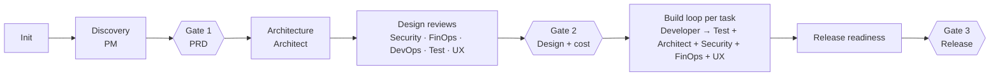

# Software Factory

A Claude Code plugin with a team of ten AI agents that can take a product from idea to release (or review and extend an existing codebase), working together through a shared handoff contract and stopping for your approval at every important decision.

| Agent | What it does |
|---|---|
| **Team Lead** | Runs the process: plans, delegates, tracks the status board, enforces the gates, curates the factory brain, talks to you |
| **Triage Classifier** | Classifies every new request first (type, size, path, which reviewers are needed) so small work takes the fast path. Read-only, runs on Haiku |
| **Product Manager** | Vision, PRD with measurable goals and NFRs, backlog of stories with Given/When/Then acceptance criteria, release acceptance |
| **Software Architect** | Mermaid repo maps, system design, ADRs, contracts, task breakdown, coding standards, and code review (clean code, OOD, DRY, patterns, scalability) |
| **Software Developer** | Implements one task at a time with unit tests, on a local branch; fixes review findings |
| **Test Automation Engineer** | Test strategy, integration/contract/E2E/performance tests, per-task verification, release regression |
| **DevOps Engineer** | Environments, containers, CI/CD, infrastructure as code, observability, runbooks — validated by dry runs |
| **FinOps Engineer** | Cost model with sourced prices, cost guardrails, cost reviews of changes, actual-vs-forecast |
| **Security Engineer** | Threat model (STRIDE), security requirements (ASVS), security reviews and scans, final release gate |
| **UX/UI Designer** | User flows, textual screen specs and design tokens, usability and accessibility (WCAG 2.2 AA) reviews of UI changes, final UX gate |

## How it works



- **Triage first.** Every request goes to the Triage Classifier, whose path (`fast-path` up to `full-lifecycle`) decides how much process runs. The Team Lead can add process, never remove it without you.
- **A factory brain per repo.** `docs/factory/brain.md` holds short, verified facts about the repo (build quirks, recurring findings) that every agent reads. Agents propose notes; only the Team Lead writes them.
- **Bounded, evidence-based loops.** At most three fix rounds per task and three attempts per failing check; "done" means command output re-run by the Test Engineer and the Architect, not the Developer's word. Every task ends as `done`, `blocked`, `max-rounds` or `stalled`.
- **One contract, one owner per artifact.** `reference/handoff-contract.md` defines every path, ID, severity level, the Definition of Done and the reply format. Every agent reads it first.
- **Your project's specifics live in your repo**, not in the agents: `docs/architecture/project-facts.md` (stack, cloud, compliance, budget), `docs/standards/coding-standards.md`, the PRD, ADRs and so on. The same agents work on any project.
- **The Team Lead is your main session.** Subagents can't ask you questions, so they return their questions to the Team Lead, which batches them for you.
- **Work is tracked in GitHub.** Tasks and findings are GitHub issues on one GitHub Project board (Todo, In Progress, In Review, Changes Requested, Done, Blocked). `docs/factory/status.md` only holds the phase, gates and open questions. The Team Lead works only on the issues you name.
- **Infrastructure has its own gate.** DevOps runs the IaC plan and reviews it, the Architect and FinOps review it, and only after all three approve and you approve the report does DevOps apply.
- **Nothing irreversible without you.** No push, merge to main, deploy, infrastructure apply, paid resource or data deletion happens without your explicit approval of that specific action.

## Install (once per machine)

This repo is the single source of truth. Install the plugin once at **user scope**, so every project on the machine gets the team. You don't need to install it again per project.

In the Claude Code chat box in VS Code (these are chat commands, not shell commands):

```text
/plugin marketplace add achisolomon/software-factory
/plugin install software-factory@software-factory-marketplace
```

When asked for the scope, choose **Install for you** (user scope).

Or from a regular terminal:

```bash
claude plugin marketplace add achisolomon/software-factory
claude plugin install software-factory@software-factory-marketplace --scope user
```

The repo is private, so the machine needs GitHub access to it (`gh auth login` or Git credentials for `achisolomon`).

## Add the factory to a new project

1. **Open the project folder in VS Code.** Ideally it's a Git repo with a GitHub remote, so the team can track work as GitHub issues.
2. **Make sure `gh` is logged in with the `project` scope** so the Team Lead can create the GitHub Project board:
   ```bash
   gh auth status
   gh auth refresh -s project   # only if "project" is missing from the scopes
   ```
   Without it, init still works, and tasks are tracked in `docs/architecture/tasks.md` instead.
3. **Start a new Claude Code chat** (plugins load when a session starts; a chat opened before the install won't see the plugin).
4. **Run init**: type `/factory` in the chat box and pick `factory-init`, optionally followed by a one-line description:
   ```text
   /software-factory:factory-init a mobile app for booking dog walkers
   ```
   The slash menu matches skill names, so typing `/software` or `/so` won't find it. Type `/factory`.
5. **Answer the project-facts questions** in one batch: stack or cloud, compliance (PII, payments, GDPR...), monthly budget, whether agents may create local branches and commits, and similar.
6. **Review what it created**:
   - `docs/factory/status.md`: phase, gates, open questions.
   - `docs/architecture/project-facts.md`: your answers, plus the GitHub Project link.
   - For an existing codebase: `docs/architecture/repo-map.md` (Mermaid map) and `docs/standards/coding-standards.md`.
   - A GitHub Project board for the repo, with columns Todo, In Progress, In Review, Changes Requested, Done, Blocked.
7. **Commit the `docs/` folder** so the team's state is versioned with the code.
8. **Start building**: `/software-factory:build <what to build>`. Name the GitHub issues you want worked on (for example `#12 and #15`). The Team Lead never picks issues by itself.

Run init once per project. Running it again on an initialized project just summarizes the current state.

**Troubleshooting**
- "No matching commands": open a new chat, or reload VS Code (`Cmd+Shift+P` → **Developer: Reload Window**), then type `/factory`.
- Check what is installed with `/plugin` in the chat, or `claude plugin list` in a terminal. software-factory should show as enabled, user scope, at the latest version.

## Updating

Claude Code runs an installed copy from its plugin cache, cached by version. Editing this repo does not change it on its own. To release a change:

1. Edit the files in this repo (never the cached copy under `~/.claude/plugins/cache/`).
2. Bump `version` in `.claude-plugin/plugin.json`.
3. Commit and push.
4. In Claude Code: `/plugin marketplace update software-factory-marketplace`, then restart the session.

To test a change locally before pushing, start Claude Code with the repo folder as a plugin:

```bash
claude --plugin-dir ./software-factory
```

## Use

In the project you want the team to work on:

| Command | What happens |
|---|---|
| `/software-factory:factory-init [description]` | Creates the `docs/` scaffold, captures project facts, maps an existing repo and derives coding standards |
| `/software-factory:build <request>` | Your session becomes the Team Lead and runs the full process for a product, feature or fix |
| `/software-factory:review [task \| branch \| path \| all]` | Parallel architecture, security, test and (if relevant) cost review with one consolidated verdict |

You can also run the whole session as the Team Lead: `claude --agent software-factory:team-lead`.

Or call any specialist directly, for example:

```text
@agent-software-factory:software-architect map this repo and review the payments module
@agent-software-factory:security-engineer threat-model docs/architecture/architecture.md
```

## Customize

- **Models**: the Team Lead picks the model for each delegation by the kind of work (Haiku for triage and mechanical steps, Sonnet for routine build and review, Opus for PRD, architecture, threat modeling and final gates). Set `Model policy: default | conserve | quality` in `project-facts.md`, or just say "conserve my limits" mid-session; conserving changes models, never steps or gates. Each agent's frontmatter `model:` is only the fallback.
- **Override one agent for one project**: copy its file to that project's `.claude/agents/` and edit it. A project-level agent with the same `name` takes priority over the plugin's.
- **Project memory**: specialists keep learnings in `.claude/agent-memory/<agent>/` per project. Commit it to share with your team, or add it to `.gitignore`.

## Layout

```
software-factory/
├── .claude-plugin/
│   ├── plugin.json
│   └── marketplace.json
├── agents/          10 agent definitions
├── skills/          factory-init, build, review
├── reference/
│   └── handoff-contract.md
├── docs/
│   └── improvement-backlog.md   ideas from similar projects: done, planned, declined
└── README.md
```
